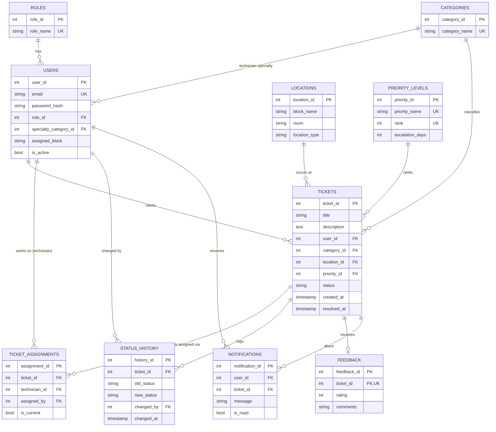

# ER diagram

Paste the block below into https://mermaid.live (or any Mermaid viewer) to get the picture;
GitHub also renders it directly on this page.

The many-to-many between tickets and technicians is `ticket_assignments`. Only one row per
ticket can have `is_current = true` (partial unique index), the rest are the reassignment history.
