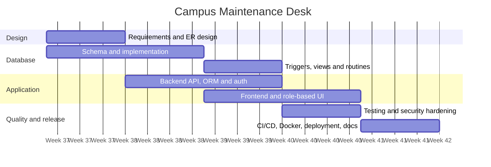

# Project timeline

Five-week plan for the Campus Maintenance Desk.

| Task | Wk 1 | Wk 2 | Wk 3 | Wk 4 | Wk 5 |
|---|:-:|:-:|:-:|:-:|:-:|
| Requirements and ER design | ██ | | | | |
| Schema and database implementation | ██ | ██ | | | |
| Backend API, ORM and authentication | | ██ | ██ | | |
| Frontend and role-based UI | | | ██ | ██ | |
| Triggers, views and stored routines | | | ██ | | |
| Testing and security hardening | | | | ██ | |
| CI/CD, Docker, deployment and documentation | | | | | ██ |

The same plan as a Mermaid Gantt chart (GitHub renders it on this page):

